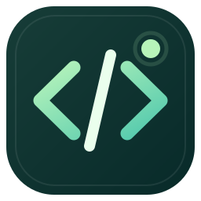
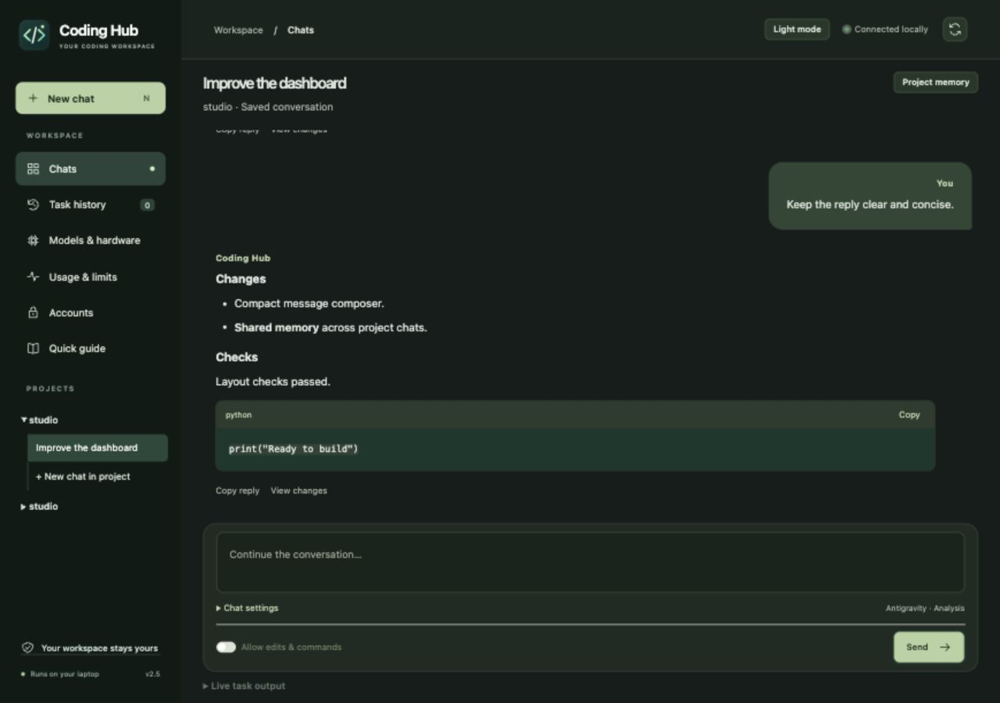
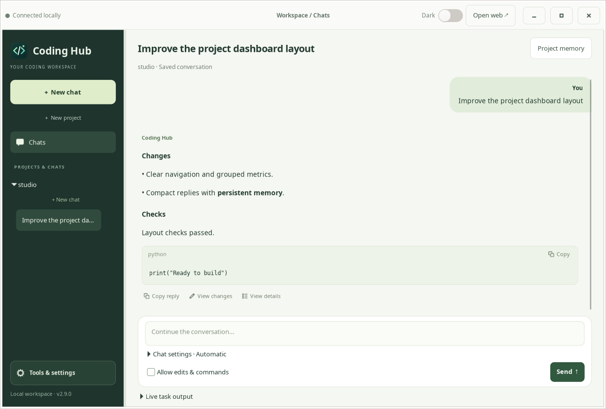
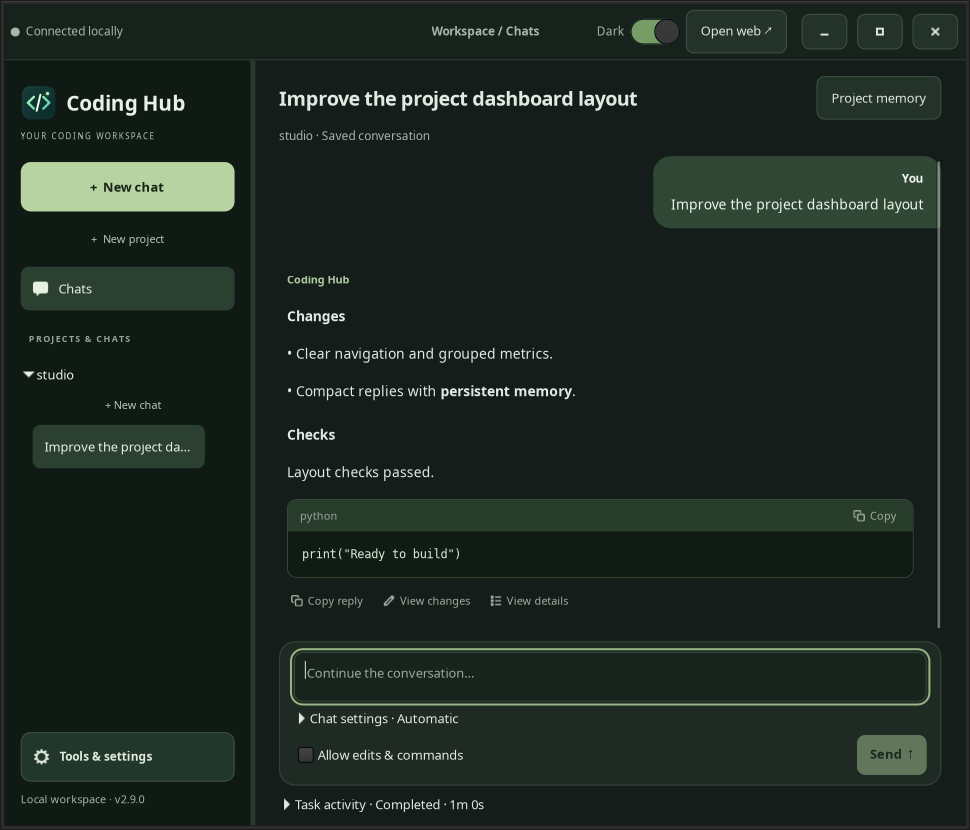
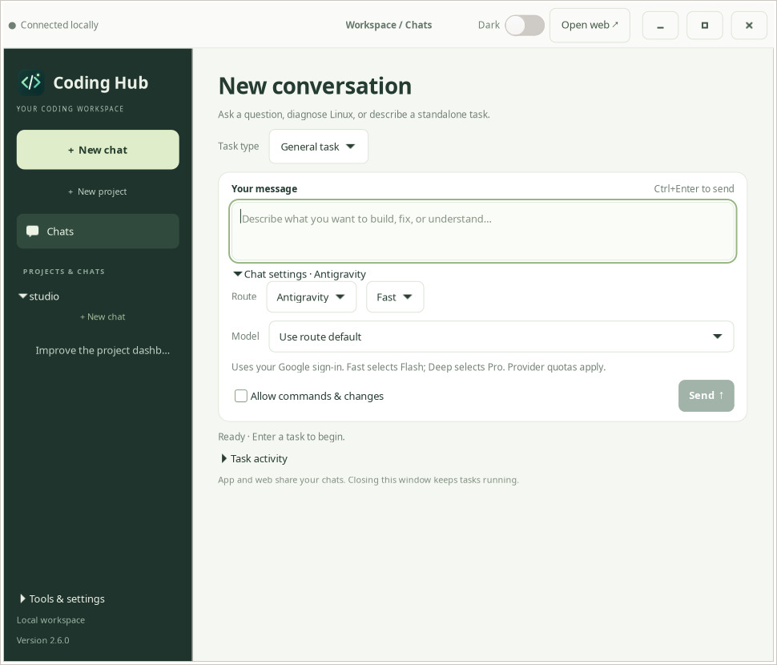
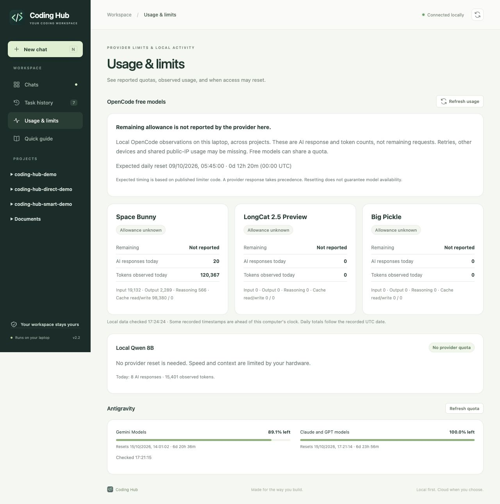
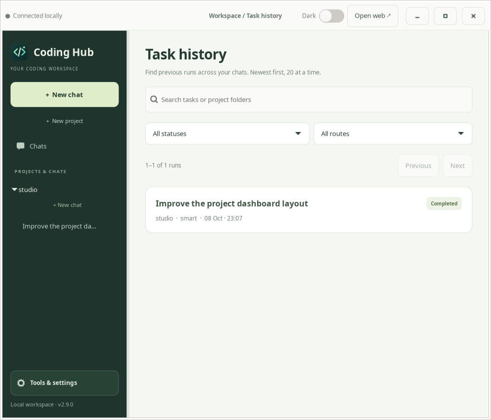
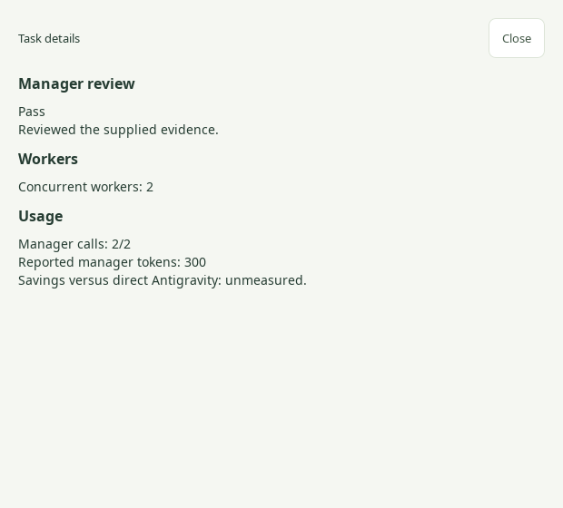
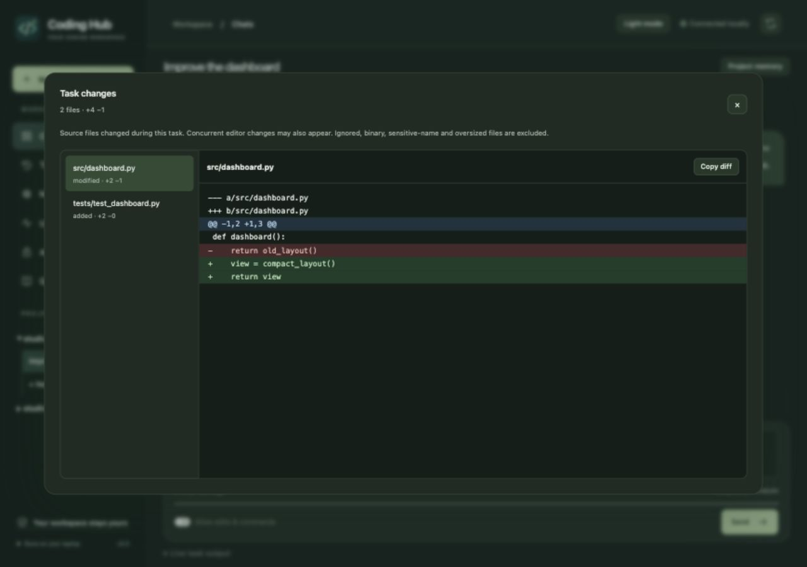

<p align="center"></p>
<h1 align="center">Coding Hub</h1>
<p align="center">A calm workspace for cloud coding agents and local Qwen.</p>

Coding Hub brings Antigravity, verified free OpenCode models, and Ollama into one workspace with **terminal, native Linux app, and web interfaces**. Use a **General task** for Linux help or standalone requests, or a **Project task** for work tied to a folder. Choose a project, describe a task, and follow its progress. Keep inference local when you want to, or use a cloud agent for larger work.



The native Linux app uses the same workspace organization, with dedicated pages for **Chats**, **Task history**, **Models & hardware**, **Usage & limits**, **Accounts**, and **Project memory**. Provider limits are grouped into cards, token breakdowns expand when needed, and project chats remain available in the sidebar. Existing chats hide the project picker, align your messages to the right and assistant replies to the left, and keep route settings in a compact disclosure. New chats let you choose General task or Project task. The sidebar starts at a compact 248 px; drag its divider to resize it, and the app remembers your width. Saved projects and chats load directly from local history, independently of model status or the last opened conversation. A failed sidebar request retries automatically without clearing existing entries. The sidebar prioritizes chats, puts new conversations first, and keeps secondary pages in **Tools & settings**. The header’s Project memory button opens the shared instructions for the current project.



*Native GTK conversation preview with synthetic messages. Actual values come from your providers and local history.*



## What you get

- Project → chat navigation in the native app and browser, with saved messages, follow-up replies, earlier-message loading, live output, cancellation, and draft recovery.
- Persistent project instructions, pinned requirements, searchable conversation checkpoints, and a local source index for focused context.
- Project-scoped MCP connections: read-only GitHub through your existing GitHub CLI sign-in, plus trusted local and HTTP servers, with lazy tool discovery for small models.
- A Usage & limits page: live Antigravity quotas, free-model local usage and observed retry times, expected daily reset countdowns, and local Qwen status.
- Opt-in Smart routing: Antigravity makes a short plan and reviews evidence; verified free models or local Qwen perform the work, with measured manager token usage and at most two manager calls.
- Automatic fallback: Antigravity → currently verified free OpenCode models → local Qwen3 8B. A handoff preserves the original task and partial changes.
- **Free automatic**, the default for fresh sessions: verified free coding models → local Qwen. No Antigravity, Claude subscription, ChatGPT subscription, or paid-model fallback. Existing saved route selections stay unchanged.
- Quota-aware selection: observed model cooldowns are skipped; a shared free-usage limit pauses the free cloud chain until its reported retry time. Missing retry times use a five-minute local backoff, not a claimed quota reset.
- NVIDIA status, actual model offload, memory usage, and a button to release the local model from memory.
- A lightweight Python backend and plain HTML/CSS/JavaScript, with no package installation or npm build required. Sign-in terminal rendering bundles unmodified `pyte` and `wcwidth`; source and licenses are in `vendor/`.
- A native Linux app window using GTK 4, with its own icon, plus a terminal menu and command-line interface.

## MCP connections

Open **Tools & settings → MCP connections** in the app or browser. Connections belong to the current project; General tasks have their own connections. Click **Connect GitHub**, then **Test connection** to verify access and see the selected account. **Enable**, **Disable**, **Edit**, and **Delete** apply to this workspace only. Changes take effect on the next task; disabling an existing connection also blocks subsequent bridge calls in a running task.

In a terminal chat, use `/mcp`, `/mcp github`, or `/mcp test github`. From a shell:

```sh
codehub mcp github --project /path/to/project
codehub mcp test github --project /path/to/project
codehub mcp list --general
codehub mcp disable github --project /path/to/project
```

Then ask in chat: **“Use the GitHub connection to review the open pull requests in owner/repository.”** The bundled GitHub adapter reads repositories, issues, PRs, changed files, checks, and text files. It is a small Coding Hub adapter, not GitHub's official MCP server. It uses `gh` in the **original project directory**, preserving project-specific account wrappers even when workers run in private copies. Run `gh auth login` if needed. It never extracts your token or creates, edits, comments, merges, or pushes through its tools. File/PR results are bounded and list tools return the first 20 entries; they are not exhaustive exports.

For another service, choose **Add custom server** and paste one connection. Install the service's supported MCP executable first; saving a connection does not install packages. Example stdio configuration:

```json
{
  "name": "my-service",
  "type": "stdio",
  "command": ["/absolute/path/to/mcp-server", "--stdio"],
  "env": {"SERVICE_API_KEY": "MY_SERVICE_KEY"},
  "tools": ["search", "read_document"]
}
```

`env` maps the server's variable to an existing variable in Coding Hub's environment. `headers` does the same for an HTTP connection; for example `"headers": {"Authorization": "MY_MCP_AUTH_HEADER"}` reads the complete header value from that variable. **Store variable names here, never tokens.** Set these variables in the environment that launches the app or CLI, then restart it. Anonymous HTTP needs no headers:

```json
{"name": "my-service", "type": "http", "url": "https://your-service.example/mcp", "tools": []}
```

The URL must use HTTPS, except HTTP on localhost. An empty `tools` list permits all tools advertised by that server; a nonempty list restricts calls to those exact names. The same JSON can be saved outside your repository and added with `codehub mcp add --project /path/to/project --config /path/to/connection.json`. Test connects to the server and lists tools without an AI request. Custom commands are executed without a shell, in the active worker directory. Use only servers and commands you trust: MCP is not a sandbox, and a custom service may change external data. Custom connections require **Allow edits & commands**; external changes cannot be rolled back by source Preview/Undo.

The bridge works through OpenCode (free, Ollama, and ChatGPT routes), Claude's strict task MCP config, and Antigravity. It advertises just three small discovery/call tools, loads at most five upstream schemas per discovery page, keeps at most two server processes warm per worker, limits results to 16,000 characters, and closes owned processes when the task ends. Up to eight connections can be saved per workspace. Smart workers receive connections; Smart managers remain tool-free. This reduces eager context loading, but does not promise fewer total tokens for every task.

Configuration lives in Coding Hub's private state directory, outside your source repository. For Antigravity, the Hub merges a single `coding_hub_tools` entry into `~/.gemini/config/mcp_config.json`, preserving other entries, and adds the narrow `mcp(coding_hub_tools/*)` allow rule in its CLI settings so headless analysis can call the bridge. Existing ask/deny rules remain authoritative. The bridge exposes no tools outside explicitly scoped Hub task environments. OpenCode and Claude receive task-specific configuration. Existing native-provider connections are not imported or managed by this panel.

Current bridge scope: MCP **tools** over stdio or Streamable HTTP, including HTTP event-stream responses. Interactive remote OAuth, legacy SSE endpoints, MCP resource/prompt browsing, sampling, elicitation, and rich image results are not implemented. For services requiring OAuth, use their vendor-supported local MCP command with its own native sign-in, if available. The bridge does not proxy provider account credentials. MCP itself does not charge a model fee; connected services can impose their own pricing and quotas.

Protocol and native-client references: [MCP transports](https://modelcontextprotocol.io/specification/2025-06-18/basic/transports), [OpenCode MCP](https://opencode.ai/docs/en/mcp-servers), [Claude MCP](https://code.claude.com/docs/en/mcp), [Antigravity MCP](https://www.antigravity.google/docs/mcp).

## How to use the app, browser, and CLI

| Interface | Start | Use it for |
| --- | --- | --- |
| Linux app | Applications → Coding Hub, or `codehub app` | Daily project chats, sign-in, quotas, and hardware |
| Browser | `codehub web`, or **Open web** in the app | The same workspace in a browser |
| Terminal | `codehub`, `codehub chat`, or `codehub run` | Keyboard workflows and individual tasks |

### Linux app

1. Open **Coding Hub** from Applications. Pin that entry to your dock if desired. Its desktop ID and icon match the running GTK window.
2. Choose **New chat → General task** for questions, Linux commands, or standalone work—no folder required. Choose **Project task** or **New project** to select a project folder. Existing chats keep their original scope.
3. Expand **Chat settings**. Use **Free automatic** for free cloud coding with local fallback. Choose **Free cloud** or **Local** to select a particular model. Antigravity lists models available to your Google account, including any Claude/GPT options your account still exposes. Smart lets you choose its Antigravity manager model and up to three cloud workers; Automatic starts with Antigravity.
4. Leave **Allow edits & commands** off for explanations. Enable it to let the agent modify project files and run commands.
5. An animated indicator shows observed activity, such as planning, a tool action, waiting for the model, or review, with elapsed time. **Stop task** remains beside Send. Click **Send** or press **Ctrl+Enter** in the message box. Enter adds a line. **Ctrl+N** starts a new chat.
6. Replies format headings, lists, inline code, and code blocks. Replies span the reading area, with small copy/review actions beneath them and language labels on code blocks. The compact composer stays below the conversation. Sending moves to the newest message; scrolling up pauses following. **Latest messages** returns to the bottom.
7. Toggle **Dark** in the title bar to save your appearance preference. **Project memory** opens shared requirements for the current project.
8. The separate **Tools & settings** gear button at the bottom of the sidebar opens a compact menu. Choose **Models & hardware** for system information. **Run system check** collects read-only diagnostics; **Discuss in general chat** prepares a message for you to send. This page also shows CPU/GPU activity, RAM/VRAM, and loaded model placement. “GPU available” means the driver works; “GPU acceleration in use” means Ollama reports model data on the GPU. GPU activity includes other applications. Samples normally refresh every 3–6 seconds.

### Browser

Run `codehub web` on the machine hosting your models and use the page it opens. Its launch URL includes a temporary connection token. The app’s **Open web** button also opens an authenticated page.

Use the same **New chat**, **Chat settings**, **Accounts**, **Usage & limits**, and **Project memory** controls. Press **Ctrl+Enter** or **⌘+Enter** from the message box to send. Code blocks have a **Copy** button. **Dark mode** saves a browser-specific preference. The desktop web layout fills the available width and height, with a stationary reply composer.

App and web share chats and running tasks; drafts and theme preferences are separate. The server stays on loopback. For another computer, use an SSH tunnel rather than exposing it publicly. OAuth browser callbacks must reach the machine running the CLI; use a provider’s headless option when offered over a tunnel.

### Sign-in and accounts

Open **Accounts → Antigravity → Sign in / manage**. Use **Google OAuth** for personal access. Complete authentication on Google’s own page, return to the panel, and choose **Done / close** to refresh status. The first launch may ask you to trust the hub’s dedicated, empty account setup folder. Use **Reconnect Google** when you want to sign out of an expired session and authenticate again.

The panel supplies arrow, Enter, Tab, and Escape controls for native provider prompts, plus a masked field for a requested code or response. Temporary sign-in output is not saved to chat history. Credentials stay in the provider CLI’s own storage.

Optional separate subscriptions:

- **Claude:** install the [official Claude CLI](https://code.claude.com/docs/en/overview), then sign in from Accounts. Choose **Claude account** in Chat settings.
- **ChatGPT:** sign in through the installed [OpenCode provider flow](https://opencode.ai/docs/providers/#openai). Choose its ChatGPT subscription option, then **ChatGPT account** and a model in Chat settings. API-key billing is not enabled by this route.

These routes use your existing plan’s limits and model eligibility. They are never selected by Automatic or Smart and do not purchase a subscription. Separate Claude/ChatGPT quotas are not exposed by this integration; consult those providers’ own account interfaces. Antigravity’s provider-reported quota groups remain visible under **Usage & limits**; model access depends on the current plan and catalog.

### CLI

```bash
codehub                              # Start chatting immediately
codehub chat --backend free-auto      # Verified free cloud → local Qwen
codehub menu                         # Optional launcher menu
codehub chat --general               # Standalone chat; no project folder
codehub chat --general --backend local
codehub run --general --apply "Run uname -s and df -h /, then summarize the output without changing anything"
codehub doctor                       # Read-only system diagnostics
codehub chat --project ~/my-project
codehub chat --project ~/my-project --backend local --model coding-hub-qwen:8b
codehub chat --project ~/my-project --continue
codehub models --backend antigravity  # Account model choices
codehub models --backend free         # Fresh zero-price check
codehub models --backend local        # Installed Ollama models
codehub run --project ~/my-project --backend free --model big-pickle "Explain the tests"
codehub run --project ~/my-project --apply "Fix the failing tests and run the relevant checks"
codehub run --project ~/my-project --backend smart-free --preview "Implement the feature"
codehub login --provider antigravity
codehub login --provider claude
codehub login --provider openai
```

Inside `codehub chat`:

- `/help` shows grouped commands; Tab completes command names. Arrow keys edit the current input.
- `/paste` accepts a multiline message. Finish with a single `.` on its own line; `/cancel` discards it.
- `/models` lists choices; `/model MODEL_ID` selects one; `/model default` restores the default.
- `/workers 1`, `/workers 2`, or `/workers 3` sets the Smart maximum cloud workers for the same task. Local fallback remains one at a time. `/models` and `/model ID` on Smart select the Antigravity manager, including account-available Claude and Gemini models.
- `/route free-auto` selects free cloud with local fallback. `/route local`, `/route free`, `/route antigravity`, `/route claude`, or `/route openai` changes route. Automatic, Smart, and Free Smart are supported too.
- `/project /path/to/folder` starts a project conversation; `/general` returns to standalone tasks.
- `/mode analysis` explains only; `/mode build` enables commands and requested changes.
- `/edit on` enables commands and requested changes; `/edit off` returns to analysis mode.
- `/doctor` prints a read-only system report and includes it in your next message. `/new` clears that pending report.
- `/changes` reviews the latest task diff; `/memory` shows shared instructions and source-index coverage; `/status` shows the current setup.
- `/delete` removes the current chat after you type `delete` to confirm. Enter cancels. Project files and shared memory stay intact.
- `/delete-project` removes the current project from Coding Hub after you type `remove project`. Enter cancels. The CLI then switches to a general chat; source files remain on disk.
- `/new` starts another conversation; `/quit` exits. Existing `:commands` still work.
- Ctrl+C cancels active work and preserves partial changes. At the input prompt, Ctrl+C exits the chat.

Interactive terminals show an animated progress line, readable replies, and labeled code blocks. Smart's internal planning/review JSON stays out of the final terminal conversation. Raw tool details remain in private logs. Redirected output stays plain text for scripts and the dashboard. `codehub open --backend local --project ~/my-project` opens the underlying agent’s full terminal interface.

### General tasks and Linux help

Use **New chat → General task** in the app/browser, or just run `codehub` in a terminal. `codehub chat --general` is equivalent. These chats are saved under **General chats**, separately from project conversations. Ask questions in analysis mode; enable **Allow commands & changes** (CLI: `/edit on` or `--apply`) when you want the agent to execute a task. For example: “Run `df -h /` and explain the disk usage without changing anything.”

**System check** runs a fixed set of read-only checks for disks, memory, CPU load, NVIDIA, time synchronization, failed services, and Secure Boot. It makes no model request and changes no settings. **Discuss in general chat** lets you review the report before sending it to your chosen model. Missing commands are shown as unavailable, not treated as evidence of a fault.

General tasks run with your normal user permissions. Administrator actions require you to run the proposed command yourself; the hub never collects a sudo password. Agents are asked to inspect first and perform only requested changes. Command mode is not an operating-system sandbox. Prefer focused requests and review the output.

Each general task starts in a private scratch folder at `~/.local/state/coding-hub/workspaces/general`; name an absolute destination when you want files somewhere else. Its chat history and memory persist across interfaces. Change review captures files inside that scratch folder only; system changes or files elsewhere must be verified through command output and direct inspection.




## Install

Requires Python 3.10 or later. Linux is the primary desktop target; the dashboard and terminal coordinator also run on macOS. Windows has a basic launcher, but full agent integration is not validated there.

The standalone Linux app additionally needs PyGObject and GTK 4. On Ubuntu 24.04 or later, if these are missing:

```bash
sudo apt install python3-gi gir1.2-gtk-4.0
```

Use the system `python3` so it can find these distribution packages. The CLI and web interfaces work without them.

Install the native agents you want to use:

1. [OpenCode](https://opencode.ai/docs/)
2. [Ollama](https://ollama.com/download)
3. [Antigravity CLI](https://antigravity.google/docs/cli/install/) for Google's native account access

```bash
git clone https://github.com/prabinadkri/coding-hub.git
cd coding-hub
python3 setup.py --local
```

Setup downloads Qwen3 8B (about 5.2 GB), creates the `coding-hub-qwen:8b` alias without duplicating its weights, and adds a Linux application launcher. Existing models are preserved. To install the launcher without downloading a model, run `python3 setup.py`.

Open **Accounts** in the app or browser to complete your Google sign-in. The coordinator calls the native CLI; it does not extract or proxy account tokens. See the interface guide above for separate Claude/ChatGPT accounts.

## Use

Choose the interface you prefer:

```bash
codehub       # Terminal menu
codehub app   # Standalone Linux application
codehub web   # Dashboard in your browser
```

If `codehub` is not on your PATH, use `~/.local/bin/codehub` instead. On Linux, **Coding Hub** in the Applications menu and `Coding Hub.sh` open the standalone app. The app icon's context menu also offers the browser and terminal. On macOS, `Coding Hub.command` opens the browser interface.

Choose a project folder and enter your task. Analysis mode is the default. Enable **Allow edits & commands** for implementation. **Fast** prefers the newest available Gemini Flash at medium effort. **Deep** prefers an available Gemini Pro/Argon, falling back to the newest available Flash at high effort. Defaults are resolved from the native account catalog before execution. Expand **Chat settings** to choose a specific model for Antigravity, Free cloud, or Local. Explicit free-model choices still require fresh zero-price verification before execution.

The app and browser share one background server and task history; reopening the app raises its existing window. The terminal uses the same routing engine, models, project memory, and saved conversations. CLI chats appear under their project in the app and browser; native CLI run logs remain separate from dashboard task activity.

The server listens only on `127.0.0.1`, and its APIs require a per-session token. The launch URL places that token in the fragment, then the app removes it from the address bar. Tasks keep running when the app window or browser tab closes. The standalone app starts the server in the background when needed. When you start a fresh server with `codehub web`, keep that terminal open until tasks finish. The app’s **Open web** button opens the browser interface.

The terminal interface remains available:

```bash
codehub
codehub status
codehub chat --project ~/my-project
codehub chat --backend local --project ~/my-project --continue
codehub run --project ~/my-project "Explain this project"
codehub run --project ~/my-project --apply "Fix the failing tests"
codehub run --backend local --project ~/my-project --apply "Add input validation"
codehub open --backend local --project ~/my-project
codehub open --backend free --project ~/my-project
```

In the dashboard, **N** starts a new chat, and **Ctrl/Cmd + Enter** runs it. Native interactive agents keep their normal edit and command confirmation prompts.

## Checks, previews, and recovery

Open **Tools & settings → Project checks** in the app or browser. Set one trusted command per line, a timeout, and zero to two free repair attempts. Commands execute directly as arguments; use an explicit shell such as `bash -lc '...'` if you need pipes or shell operators. Settings are private to this project and are not loaded automatically from repository content.

Coding tasks with edits enabled run the fixed commands before and after the agent works. After the agent finishes, supported web projects also run browser checks by default. The saved result includes actual exit codes, output, duration, baseline failures, browser results, and repair attempts. Failed final checks mark the task **Needs review**. Without command or browser coverage, the result says **Not independently verified**. Passing checks only establish what those checks cover; they do not prove general correctness. Repairs use verified free/local models, never additional premium manager calls. Browser and command failures share the same maximum of two repair attempts.

```bash
codehub checks --project ~/my-project --command "python3 -m unittest discover" --repairs 1
codehub verify --project ~/my-project
```

In **Chat settings**, choose **Preview source edits before applying** and enable edits. Or use `--preview` in `codehub run`, or `/mode preview` in terminal chat. The agent works in a private source copy, including current uncommitted source. Open **View changes**, select a file, and use **Apply this file**. Use **Undo this file** to restore its before-task contents. Applying individual files can leave a partially integrated feature; run the project checks afterward.

```bash
codehub changes --project ~/my-project
codehub apply --project ~/my-project --task TASK_ID src/example.py
codehub undo --project ~/my-project --task TASK_ID src/example.py
```

Apply/undo compare complete file contents and permissions before writing. If a file changed afterward, the operation stops without overwriting it. CLI file lists are preflighted together. Checkpoints cover eligible source and common assets: at most 20,000 files, 128 MiB total, 8 MiB per file. Dependencies, generated/ignored files, dotfiles, and sensitive filenames are excluded; over-limit or linked eligible source refuses the coding task before editing. Preview is not an operating-system sandbox. Commands can have external effects; database, package, network, and system changes cannot be rolled back. Dependencies are not copied, so a preview may need its own environment to run checks. Checkpoints remain in private task storage until the chat/project is deleted.

Terminal shortcuts: `/checks COMMAND`, `/checks clear`, `/verify`, `/apply TASK_ID FILE`, and `/undo TASK_ID FILE`.

## Task queue and local model coordination

Send additional messages while a task runs to queue them. **Tools & settings → Task queue** shows running/waiting tasks, pause/resume, move up/down, and cancel controls. The dashboard runs one task at a time. Pausing leaves the current task running. After a restart, waiting tasks are restored paused so you can review them before resuming; interrupted tasks are not automatically rerun. Up to 100 tasks may wait. The CLI normally executes immediately and respects workspace locks. Add `--queue` to `codehub run` to enqueue in an already-running app/web server. Use `codehub queue`, `codehub queue pause`, `codehub queue resume`, `codehub queue up TASK_ID`, or `codehub queue cancel TASK_ID`. Terminal chat also accepts `/queue`.

All Hub-managed local agent calls share a per-user OS file lock at `~/.local/state/local-ai-resource/ollama.lock`. This serializes local workers across Hub processes; a crashed process automatically releases its lock. The accompanying local NEPSE integration uses the same lock. Other applications and `codehub open` use their own inference paths unless they explicitly adopt this coordinator. A waiting caller can be canceled. The lock limits simultaneous inference, not model residency: Ollama keep-alive still controls when weights unload. **Release local model** remains available when Hub is idle.

## Browser application checks

Browser tests are optional. Install their development dependencies once in the Coding Hub directory:

```bash
npm ci --ignore-scripts
npx playwright install chromium
```

In a project chat, click **Test website**, type **“test this website”**, or send **`/browser-test`**. The app, web interface, and terminal route these requests directly to the browser runner without an AI call. Results are saved in the same conversation. The quick action preserves your unsent draft, uses the shared task queue, and can be stopped like other tasks. The small **Browser report** action opens that turn's screenshots and results; the web version also downloads the trace. `/browser-test http://127.0.0.1:3000` tests an explicit local URL for that turn without changing saved settings. Mixed requests such as “build a page and test it” still go to your agent and receive the automatic checks after coding.

For supported projects, **no URL or JSON configuration is required**. Hub discovers Vite, Next.js development apps, Astro, Create React App, and standalone `index.html` sites in the selected folder or common `frontend`, `web`, `client`, `app`, `website`, `site`, `apps/*`, and `packages/*` folders. It starts a temporary server on an available loopback port, waits up to 60 seconds for readiness, runs Chromium, then stops its server and child processes—even on failure or cancellation. Existing explicitly configured servers are left running. Dependencies must already be installed; Hub does not install packages or guess arbitrary startup scripts. Multiple detected web apps require selecting the specific app folder or configuring its URL.

Automatic checks inspect the homepage and up to two ordinary local links at desktop (1365×900) and mobile (390×844) sizes. They detect console errors, uncaught page errors, failing local document/script/style/API responses, empty pages, and horizontal overflow. They do not randomly click buttons, fill forms, or infer every business workflow. URL navigation stays on the configured local origin. Screenshots capture the visible viewport and traces capture the interaction.

After successful coding tasks with edits enabled, these browser checks also run automatically when a supported web app or explicit URL is present. Analysis-only conversations do not trigger them unless you explicitly request a browser test. You can turn this off per project in **Tools & settings → Project checks → Automatically test web apps after coding changes**. Preview copies are tested separately; a saved URL is skipped in preview mode to avoid accidentally testing the original application. Preview dependencies are not shared automatically, so a missing environment is reported rather than claiming success.

For other frameworks, use **Project checks** to set a running localhost URL. An optional **Start command** starts it if the URL is unavailable; it runs as literal arguments in the selected project folder, with no implicit shell. Start commands you configure must bind to loopback and serve that URL. Leave both fields blank for discovery. Both startup and browser execution have bounded timeouts. To test particular user interactions, optionally save browser steps, for example:

```json
[
  {"action": "fill", "selector": "input[name=title]", "value": "Example"},
  {"action": "click", "selector": "button[type=submit]"},
  {"action": "text", "selector": "h1", "value": "Example"}
]
```

Supported actions are `click`, `fill`, `text` (contains text), `visible`, and `url` (URL contains value). Saved steps run after desktop/mobile checks of the starting page, instead of automatic link exploration. **Test application** in settings and `codehub browser-test --project ~/my-project` remain available. Each run saves screenshots, step results, server output (when started by Hub), and a Playwright trace privately; a failure attempts a screenshot too. Traces may contain data shown by your application, so use test data. Browser runs use no model tokens; enabled AI repair attempts use free/local models.

```bash
npx playwright show-trace /path/from/the/result/trace.zip
npm run test:browser  # Hub's own isolated browser regression suite
```

The suite uses synthetic projects, an ephemeral authenticated server, real browser interactions, and a trace. It does not use your account or generate model requests.

## Symbol context and model observations

The existing local search index now also extracts Python functions/classes, signatures, imports, and call references using Python's AST. Related definitions and syntactic references enter a bounded context packet; source lines must still be re-read before editing. The index updates incrementally and removes deleted entries. Other languages retain text retrieval. This is not a resolved whole-program call graph, and partial indexing remains labeled.

Open **Tools & settings → Model observations**, or run `codehub metrics` / `/metrics`. It shows the last checked free-model eligibility, observed cooldowns, local-slot occupancy, last success, sample counts, average duration, and independently checked outcomes. These are task-dependent observations, not a benchmark or a promised success rate. Unknown pricing is never authorization to run a paid model. No background model benchmark consumes your allowance.

## Smart manager and workers

Choose **Free Smart** to use a freshly verified zero-cost cloud model for planning/review and free/local workers for implementation. Its manager selector lists eligible free models. At most two bounded manager calls run; short analysis questions skip the manager. If the chosen manager is unavailable, the task stops and you can choose another model or Free automatic. There is no subscription fallback. Actual provider token totals are shown only when reported; smaller token use or identical quality cannot be guaranteed against an unrun standalone task.

Choose **Smart** for your existing Antigravity manager, or run:

```bash
codehub chat --backend smart --project ~/my-project --apply
codehub run --backend smart --model claude-sonnet-4-6 --workers 2 --project ~/my-project --apply "Build the frontend and backend for this system"
```

Choose **Smart → Manager model** in Chat settings, or use `/model MODEL_ID` / `--model MODEL_ID` in the CLI. Choices come from your Antigravity account's current model catalog, including its available Claude, Gemini, and other models. A selected model is used for both planning and review; it never silently switches to a worker model. With **Use route default**, Fast prefers available Gemini Flash; Deep prefers an available Gemini Pro/Argon or falls back to Flash High. No fixed, retired model ID is used. Separate Claude/ChatGPT subscriptions remain direct routes.

Choose **Cloud workers: 1, 2, or 3**. This is one request in one chat: for example, the manager can assign frontend files to one worker and backend files to another, with a shared API contract. Workers use distinct currently verified free models. Each receives a private copy of eligible project source, including uncommitted files. Their allowed file lists must be disjoint. After they finish, Coding Hub checks file ownership and checks that the originals have not changed, combines the edits, and runs a free/local integration worker to check interfaces, run tests, and fix integration issues. The manager then reviews bounded reports and observed evidence. The normal **View changes** action shows the final changes in your project.

The count is a maximum, not a demand to split every task. General/system tasks and analysis stay sequential. Unsafe/overlapping plans, insufficient free models, linked source, or copies exceeding 20,000 files / 128 MiB fall back to one worker. Dependencies, secrets, dotfiles, and generated folders are not copied. Worker copies are a conflict-prevention mechanism, not an OS security sandbox. Failed or conflicting assignments remain in the private task folder for inspection without being integrated; successful copies are removed. Free cloud failures can fall back to local Ollama, with only one local worker running at a time within the task. Provider quotas still apply; more workers are not unlimited free capacity. Stop cancels the worker processes as well as later stages.

Each task has a limit of two manager invocations, an 18,000-byte supplied prompt limit per invocation (including its response schema), bounded combined evidence that does not grow with worker count, and a two-minute timeout per invocation. Short sequential analysis requests skip planning. Manager calls use a tool-free custom agent in a separate private directory to avoid automatic project discovery. Responses are schema-validated. The provider CLI adds its own prompt and reasoning overhead and exposes no hard total-token limit; the byte limit is not a token cap. Requests are limited to 6,000 UTF-8 bytes.

A rejected review stops with **Needs review**, preserves the worker's changes, and gives next steps. No recursive manager repair loop or automatic direct-Antigravity implementation is started. Provider failure and unavailable reviews remain incomplete. Stop cancels further work.

The result shows the provider-reported manager token total; the full breakdown is saved privately in the task's `smart.json`. Missing usage is shown as unavailable. Direct Antigravity is not run again merely to measure a baseline. **Lower token usage and equal quality cannot be guaranteed for every task.** Two native manager calls can cost more than a quick direct answer. Smart is intended for focused implementation where workers can handle most exploration and coding. Its review sees partial evidence, not the complete repository or an independent execution of every test. Review the actual changes and validation output.

In one paired checkout-validation test, Smart used **8,171 reported Antigravity tokens** versus **122,733** for direct Antigravity, about **93.3% less**. Both passed the same eight independent acceptance checks. This small example is not a general quality or savings guarantee; worker tokens are excluded from this Antigravity-only comparison. See [the benchmark details](docs/smart-benchmark.md).

A second frontend/backend check with Sonnet and two parallel workers used **10,316 reported manager tokens** versus **15,587** for direct Sonnet (**33.8% less**); both passed nine independent checks. This development run exposed response-length validation issues, now covered by regression tests. The benchmark notes disclose the reused plan, revalidated review, discarded attempt, and separately reported cache reads.

## Delete a chat

In the app or browser, hover over a chat in the sidebar (or focus it with the keyboard) and click the small trash icon, then choose **Delete chat**. **Cancel** keeps it. In the terminal, use `/delete` in the current conversation and type `delete` to confirm.

Deletion removes that chat’s saved messages, searchable conversation history, checkpoints, task activity, logs, and change previews from Coding Hub’s local state. It cannot be undone. Project files (including any changes made during the chat), shared pinned requirements, instruction files, the source index, and other chats are kept. Provider-side sessions and usage records are managed separately by their providers. Wait for any active task in that workspace to finish before deleting a chat.

Deleting the open chat takes you to a fresh chat. The app and browser refresh their shared history automatically; a terminal whose chat was deleted elsewhere must use `/new` before sending another task.

## Remove a project

Hover over a project heading in the app or browser sidebar, or reach it with keyboard focus, and choose its small trash icon. Confirm **Remove project** to remove all of that project's saved chats, task logs, change previews, checkpoints, source index, and pinned Coding Hub memory. **Cancel** leaves everything intact. The project folder, source files, Git history, and instruction files such as `CODING_HUB.md` and `CLAUDE.md` are never deleted. This only affects local Coding Hub records; provider-side sessions and usage records are separate.

Removal is blocked while a task in that project is queued, running, or stopping. Removing the open project returns the app/browser to a new general chat and clears its saved selection. Other projects and General chats are preserved. You can choose the same folder and start a new chat to add it again; its deleted history and pinned notes cannot be restored. A small local removal marker prevents stale windows from re-adding it automatically. General chats have individual chat deletion, rather than a project removal action.

## Project instructions and long conversations

Use **Project memory** in the app or browser to pin requirements that should apply to every task. Pinned text is kept verbatim, up to 4,000 UTF-8 bytes. It is saved privately outside the project. To create an editable instruction file inside a repository:

```bash
codehub init --project ~/my-project
```

This creates `CODING_HUB.md` with sections for architecture, development commands, constraints, and working practices. It refuses to replace an existing file. Existing root `AGENTS.md`, `CLAUDE.md`, and `GEMINI.md` files are also respected and never overwritten. Up to 5,000 bytes of project-file guidance are included directly; larger files are identified for the agent to read as needed. Keep instructions concise and specific.

Each chat stores its original goal, user messages, assistant results, completion state, and immutable per-turn checkpoints. A follow-up retrieves the latest turns and relevant earlier discussion. The app and browser group chats under their project, and can load earlier messages on demand. The CLI offers the same continuity:

```bash
codehub run --project ~/my-project "Explain the checkout flow"
codehub run --project ~/my-project --continue "Now add validation for negative amounts"
codehub chat --project ~/my-project --continue
codehub memory --project ~/my-project
codehub memory --project ~/my-project --pin "Preserve public API names. Use pytest."
```

Inside `codehub chat`, use `:new`, `:memory`, or `:quit`. Edit permissions are explicit for each run; use `--apply` when implementation is intended.

## Large repositories and focused context

Before a task, a local SQLite FTS5 index scans eligible source files and updates changed files. Retrieval ranks matching paths and code chunks, then includes a small selection with file and line references. It uses lexical search and needs no embedding service or additional model.

- Git repositories respect Git's ignore rules. Dependencies, generated directories, common secret filenames, binary files, and symlink targets are excluded.
- Individual indexed files are limited to 256 KiB. Normal updates have a 12-second work budget and a 128 MiB read budget; unfinished scans continue across runs, prioritizing unindexed files.
- The added memory/retrieval packet is capped at 12,500 UTF-8 bytes. The current request, native agent prompt, and tool schemas use additional context.
- OpenCode automatic compaction and pruning remain enabled, with 6,144 tokens reserved. The agent is prompted to search first, read focused ranges, work in small testable steps, and report decisions and next steps.

For a large first scan, prepare the index ahead of time:

```bash
codehub index --project ~/my-project --seconds 120
```

A synthetic validation indexed 10,000 small source files in about 4.7 seconds on one development machine and selected 656 bytes for a targeted symbol query. A live local Qwen test found a function in a separate 1,000-file demo and correctly recalled a project requirement on the next turn. These are focused checks, not a guarantee for arbitrary codebases. Large files, broad architectural changes, ambiguous queries, and difficult reasoning can still require manual direction or a stronger cloud model.

## Model availability and Kimi

Antigravity and Smart list models returned by the signed-in native `agy models` command. All returned models are selectable, including future versions without a Hub update. The list refreshes about every five minutes; the web toolbar **Refresh** and the app's model-row **Refresh** also reload it immediately. Saved choices missing from the latest list are labeled **unavailable / not verified**, never silently replaced. Execution rechecks explicit Antigravity selections; Smart resolves and pins its manager once for both planning and review. An unavailable catalog stops that route, while Automatic can continue to its free/local fallback.

As announced in [Google's current model documentation](https://antigravity.google/docs/models), legacy Claude 4.6 and GPT-OSS 120B are scheduled for removal on **November 2, 2026**. The picker labels those legacy entries while the native CLI still lists them. This does not mean all Claude models are disappearing: newer versions depend on plan eligibility. Model availability and remaining quota are different checks.

Free cloud choices are a reviewed coding shortlist, dynamically filtered by live zero-cost metadata; they are not every model marketed as free. Prices are fetched again before each run, and helper models remain pinned to the same free model. New families require review rather than automatically sending project code to an unknown provider. Optional subscription routes remain separate.

As of **October 27, 2026**, [Kimi K3.1 Pro and Highspeed](https://www.kimi.ai/blog/kimi-k3-1-pro) are the latest Kimi release. The [official API](https://platform.kimi.ai/) lists paid pricing; Kimi K2.5 Free is deprecated in OpenCode's catalog. No current, verified free K3.1 Pro endpoint was found for this integration, so it is not added to the free route. Free access in a provider's website does not establish a free API for a coding agent.

## Antigravity quota

The browser quota card and the native app's **Usage & limits** page show remaining percentages, provider reset times, countdowns, and the last successful check. You can refresh manually or use:

```bash
codehub quota                      # All providers
codehub quota --provider antigravity
codehub quota --provider free      # Local read only; no model requests
codehub quota --provider local
```

The hub invokes `agy -p /usage --output-format json`. This is Antigravity's own slash command, which returned structured quota groups with zero model turns in validation. It does not extract tokens or call private account APIs. Background checks are limited to once every five minutes. Failed refreshes retain the last known snapshot with a stale/error label; missing reset times stay unknown. Percentages apply to the provider's shared model groups. See [official quota documentation](https://www.antigravity.google/docs/cli/commands/usage).

## Free-model usage and reset times



Open **Usage & limits** in the browser sidebar or **Usage & limits** in the native app. The tracked coding models each show today's locally observed AI responses and tokens, with input, output, reasoning, and cache details. The same data is available with `codehub quota --provider free`.

**Remaining allowance is shown as “Not reported.”** The current free-model integration has no public remaining-quota endpoint. Counts read from OpenCode's local database are not the provider's request counter: retries, traffic from other devices, and shared public-IP usage may be missing. A free model is not an unlimited model.

The [published OpenCode free limiter](https://github.com/anomalyco/opencode/blob/5d9cd9b259f0456522f318a7435501d03cfbee79/packages/console/app/src/routes/zen/util/ipRateLimiter.ts) uses UTC-day buckets and can share limits across models on the same public IP. The hub shows an **expected** daily reset at 00:00 UTC (05:45 in Nepal), converted to your device's time zone. This is source-based timing, not a live guarantee or a promise of restored availability; production rules can change. No undocumented “200 requests” allowance is assumed.

When OpenCode records an HTTP 429 error with `Retry-After`, the model card displays that provider-reported retry time and the observation time. Expired retry windows say access has not been rechecked. A later successful response clears the old limit observation. An error without a retry time stays unknown. These observations do not trigger quota probes, network changes, or bypasses.

Usage refreshes read the local SQLite database in read-only mode, at most once every 20 seconds automatically, with a manual refresh button. No prompts or account tokens are sent anywhere. Queries retrieve model usage/error metadata, not conversation text or source content. Raw error bodies and headers are never returned to the interface. Missing, busy, or unsupported databases show unavailable usage rather than zero. Daily counts use recorded UTC dates; records ahead of the current clock are labeled. Refresh timers tolerate system-clock corrections. Local Qwen shows no provider quota or reset requirement; hardware and context limits still apply.

The default database is `$XDG_DATA_HOME/opencode/opencode.db`, or `~/.local/share/opencode/opencode.db`. For a custom OpenCode installation, set `CODING_HUB_OPENCODE_DB` to its database path. See the [official OpenCode CLI usage commands](https://opencode.ai/docs/cli/#stats).

## Performance and limits

Qwen3 8B uses Q4_K_M weights, 16K context, a 2,048-token output limit, and explicit thinking-off requests for focused tasks. Local title and summary generation are disabled. The NVIDIA driver must be active for GPU offload. A 4 GB GPU cannot hold the full model; mixed CPU/GPU execution is expected.

The 16K setting is a hardware compromise, below [Ollama's documented 64K+ OpenCode requirement](https://docs.ollama.com/integrations/opencode). Small tasks work in testing; individual requests and tool results can still exceed the limit even with retrieval and checkpoints. Prefer cloud agents for complex work. See [GPU setup](docs/gpu-setup.md) for driver troubleshooting.

Free automatic checks current free-model pricing and observed cooldowns, then tries local Qwen if cloud access is unavailable. It never starts subscription routes. Automatic still starts Antigravity first when you explicitly select it. Pricing is fetched only when the free route is reached. Dashboard status uses a short cache; it never authorizes a paid request from cached pricing. There is one active dashboard task at a time, and the coordinator also locks each workspace. Process-lifetime locks release when the owner exits; abandoned lock files from older versions are recovered automatically. An active task remains protected from concurrent changes.

Default free selection skips a model until its recorded `Retry-After` time. A shared free-usage limit skips the free cloud chain; a later successful free response clears that shared observation. With no reported retry time, the hub backs off for five minutes. This is a local retry policy, not a provider reset promise. Choosing an explicit **Free cloud** model allows a deliberate retry. Cancellation and task timeouts stop execution without starting a second agent.

## Free access and privacy

The preferred coding shortlist is DeepSeek V4.1 Flash, GLM 5.3 Flash, Reflection Beam, MiMo V2.6 Flash, and Big Pickle. Historical Space Bunny and LongCat entries remain tracked for usage, but are absent from the picker when the provider no longer lists them as active and free. New additions are coding-focused models: see [DeepSeek's release](https://www.deepseek.com/en/news/deepseek-v4-1-flash/) and [Beam's OpenCode integration](https://reflection.ai/blog/beam-is-available). Selection requires current zero prices for every recorded cost, tool support, and a non-deprecated entry in [models.dev](https://models.dev). The primary and helper models stay pinned to that same free model. An arbitrary model with “free” in its name is never automatically added.

The shortlist was reviewed on October 27, 2026 against the [current OpenCode model/pricing page](https://dev.opencode.ai/v2/docs/console/models). GLM and MiMo passed a live file-editing task and six independent checks through the installed official CLI. DeepSeek, Beam, and Big Pickle also passed live read-tool smoke checks. Nemotron 3 Ultra was listed at zero cost but returned “Model is unavailable” in a live check, so it was excluded. This verifies basic integration, not broad coding quality. It is a selection policy, not a claim that one model is best for every repository. If current pricing cannot be checked, the free cloud route is skipped. Catalogs can lag provider changes, so this is not a billing guarantee. Keep accounts on free access and do not add payment details or select paid models manually. Provider quotas and promotions can change.

Setup sets Antigravity's `useG1Credits` preference to false and backs up existing settings once. No credit purchases are made. [OpenCode's free Big Pickle terms](https://opencode.ai/docs/zen/) say free-period data may be used to improve the model.

Cloud routes send task content and relevant files to their provider. Local inference uses Ollama on this machine. Coding commands can still access the internet, such as to install project dependencies. Edit mode permits shell execution and is not an operating-system sandbox. Review changes and actual test results; a completed agent response does not guarantee correct code.

Private task records, source search indexes, pinned requirements, conversation checkpoints, quota snapshots, logs, pricing metadata, and dashboard session details are stored in `~/.local/state/coding-hub`, outside the source tree. Do not publish that directory. The repository contains no model weights, account credentials, task transcripts, or machine-specific connection settings.

## Development

Run the repeatable local test workflow from the repository:

```bash
python3 tools/check_all.py            # Python/CLI/API, JavaScript syntax, native GUI
python3 tools/check_all.py --no-gui   # Core checks on a machine without GTK/display support
python3 tools/check_all.py --gui-only # Native GUI and saved-chat startup checks
```

The runner prints a report directory containing `summary.json`, individual logs, and native screenshots. It returns a nonzero exit code if any requested check fails. `--output /path/to/new-directory` chooses where to save the report. Core checks require Node.js for JavaScript syntax; GUI checks need Linux, GTK 4/PyGObject, `dbus-run-session`, and either Xvfb or Xephyr with an existing graphical session. Xvfb stays hidden; Xephyr opens a separate test window. With Xephyr already installed, no additional display server is needed.

These are scripted regression checks, not random clicking: they manipulate real GTK widgets with sample data and assert expected results. The runner uses separate state, makes no AI generation requests, and consumes no model tokens. The web API is covered by the Python suite; JavaScript syntax is checked, but browser clicks and rendering are not automated by this runner. Live model coding checks are separate and consume the selected provider's allowance. Screenshots aid visual review; they are not a pixel-by-pixel comparison against a baseline.

The tests cover free-price rejection, fallback and cancellation, literal subprocess arguments, dashboard authentication, project isolation, incremental retrieval, bounded long-conversation context, instruction-file preservation, quota parsing, free-model usage isolation and retry-time handling, chat history, isolated parallel assignments and integration conflicts, serialized local fallback and cancellation, Smart model selection and call limits and review failures, and real background-server lifecycle. CI runs the suite on Linux and macOS. A separate native UI check builds the real GTK widgets with synthetic data, renders all six pages and existing conversations at two window widths, plus dark-mode previews. It checks chat deletion and cancellation, Ctrl+Enter, scroll following, reading-position preservation, compact composer size, model selection, temporary sign-in controls, theme persistence, message alignment, project-picker visibility, conversation navigation, task history, memory isolation, and refresh behavior without sending model prompts.

To run that Linux UI check (requires GTK 4, PyGObject, Xvfb, and a session bus):

```bash
xvfb-run -a dbus-run-session -- python3 tools/check_desktop_ui.py --output /tmp/coding-hub-ui
```

These renderings use an isolated temporary state directory and do not read your saved chats or provider credentials.

Licensed under [MIT](LICENSE).

### Finding previous runs

Open **Tools & settings → Task history** when you need a run across chats. Search by task text or project folder, filter by status or route, and use **Previous / Next** to browse 20 runs per page, newest first. This includes archived runs beyond the recent activity list. Opening a result returns to its chat and task output. History is loaded on demand from local metadata, without loading every log or calling a model.



### Reviewing replies and file changes

Replies use readable Markdown, code blocks, and a **Copy reply** button. The browser also offers **Copy** on each code block. Detailed tool output stays under **Task activity**. Smart replies show the main answer by default; the small **View details** action reveals the manager review, worker attempts, and reported token usage. Older saved Smart replies use the same presentation. Findings that need your attention remain in the main answer. In terminal chat, use `/details` for the latest reply’s Smart details. Opening details uses no model tokens.



After a new task with **Enable edits** finishes, choose **View changes** under its reply. Select a file to see green added lines, red removed lines, and line numbers in the diff headers. These are before/after snapshots of that task, so earlier edits are not presented as new work. Concurrent edits from another editor can still appear. New coding tasks include private recovery checkpoints. Use **Apply this file** for a preview, or **Undo this file** for an applied change. Both refuse to overwrite later edits. Older tasks retain read-only diffs.

In terminal chat, type `:changes`. Outside chat, run `codehub changes --project /path/to/project`, optionally adding `--task TASK_ID`. The command defaults to the latest saved task. Historical tasks and analysis-only tasks have no change snapshot.

Recovery checkpoints cover eligible source and common binary assets within the limits described above. Text diffs include UTF-8 files up to 256 KB each and show up to 64 files / 200 KB of diff content; larger/binary captured files still have Apply/Undo controls. Partial coverage is labeled. Reviews and chat history stay in private application state, outside the project; this is not a backup of every file.



### Opening files mentioned in replies

Click an underlined file or folder in an assistant reply, such as `cypress/screenshots/`, `.cypress-e2e.log`, or `src/app.py:42`. The app and web interface open a read-only preview with **Show in Files**, **Copy path**, **Refresh**, and **Parent folder** actions. Screenshot folders are browsable, supported images display inline, and text references can highlight a requested line. The web interface also offers **Download** for files up to 20 MiB. Show in Files uses the file manager on the computer running Coding Hub; remote web users can use Download instead.

References are detected when opening saved chats, including older replies. Paths are resolved against that reply’s project. If a relative path is missing at the root, a bounded search checks package subfolders (excluding dependency, cache, and private directories). A unique result from a complete search opens directly; multiple matches or a partial search offer a location chooser. Explicit absolute paths are never relocated. This also works with older monorepo replies such as `cypress/screenshots/` when artifacts actually live under `frontend/cypress/screenshots/`. Relative paths from preview tasks use the preview workspace. The preview shows the file’s current contents, not a historical snapshot. Missing files produce a clear message and a copyable reference. Quoted paths or Markdown links support spaces. References inside code blocks stay literal.

Previews read at most 128 KiB of text and display up to 600 lines; large `.log` and `.jsonl` files show their latest output. Requested lines outside the bounded preview are labeled. Images are limited to 8 MiB. Folders show 100 entries per page from a bounded scan of 2,000 entries. Show in Files provides access to the full file or listing. Symlinks, credential paths, and files outside the project or that reply’s saved browser artifacts are not opened through this feature. File previews do not execute files or use model tokens.

In terminal chat, use `/files` to list references from the latest reply, `/files PATH` to preview text or a folder, and `/reveal PATH` to show the location in your desktop file manager. Paths may include spaces without shell quoting. These commands keep your conversation and selected model unchanged.

### Provider access troubleshooting

The CLI's native stream errors are monitored for reported free-usage limits. If a provider retries without emitting a final JSON error, Hub stops those retries and records a five-minute local backoff when no reset is provided. That backoff is not a claimed allowance reset. A provider can reject restricted manager requests even when a normal coding request works; Free Smart then stops clearly without enabling tools or switching to a subscription. Choose Free automatic to continue normal coding.

A model's **Price verified** status means its published price is zero; it does not guarantee service access. If OpenCode's free service returns “free tier can only be used from within OpenCode” even from the official CLI, choose Antigravity or Local. Related upstream reports include [an official CLI free-tier rejection](https://github.com/anomalyco/opencode/issues/52907). Coding Hub keeps analysis-mode permissions restricted and does not bypass provider access controls.

If Claude reports an expired OAuth session, open **Accounts → Claude → Sign in** and reconnect. “Sign-in saved” only indicates saved sign-in metadata; the provider confirms validity when used. ChatGPT requires an explicit model selection after subscription sign-in.

The native **Open web** action uses the Linux desktop’s browser launcher and reports launch errors. Snap and Flatpak browser registrations are recognized even when the app was started over SSH. If no browser is configured, choose one in Linux **Settings → Default Apps**.

## Circuit Studio integration

Use **New circuit** in the app or browser sidebar. Coding Hub creates a ready-to-use
workspace automatically. Describe your circuit, select your model, enable **Allow
edits & commands**, and send. **Open circuit in Studio** opens the saved
`design.circuit` directly. No folder selection, copied path or manual plugin setup
is needed. **Return to previous draft** restores the draft you had before opening
the circuit assistant. Creating/opening a workspace does not submit a model request.

From Circuit Studio, use **Design with Coding Hub → Start circuit chat**. It sends
a separate copy of the current circuit and opens the correct Coding Hub chat
workspace. When the task finishes, return to Studio and use **Check for result →
Bring into editor**. Studio refuses to replace a circuit edited since the handoff;
**Save edited copy** remains available. This workflow opens Coding Hub in your
browser; it does not embed a separate model inside Circuit Studio.

Coding Hub can create and edit portable Circuit Studio projects through the
same component engine and solver used by the graphical app. Install
[Circuit Studio](https://github.com/prabinadkri/circuit-studio), then initialize a
circuit workspace:

```sh
codehub circuit init --project /path/to/lab --studio /path/to/circuit-studio
```

Select that lab folder in Coding Hub and enable **Allow edits & commands**.
Ask, for example: “Create a 5 V voltage divider with two 10k resistors. Verify
2.5 V at its output, run electrical checks, and export a schematic SVG.”
The integration supplies project instructions and commands for catalog lookup,
transactional edits, revision checks, simulation and exports. Open the generated
`.circuit` file in Circuit Studio to edit it graphically. Save an open editor's
work before editing its file with an agent, then reopen the result.

`codehub circuit --help` lists the commands. The integration preserves the
existing provider permissions and model configuration; analysis-only tasks
cannot run edit commands. Analog simulation does not imply MCU firmware
co-simulation. See Circuit Studio's `docs/AUTOMATION.md` for JSON plans, limits
and its optional MCP stdio adapter.
